<div align="center">


# YMOJ

**从一道题的练习，到一场比赛的组织。**

面向算法学习与竞赛的开源在线评测平台


[](LICENSE)

[功能概览](#功能概览) · [页面预览](#页面预览) · [技术架构](#技术架构) · [部署指南](deploy/README.md) · [反馈问题](https://gitee.com/yemiaoo/ymcloud/issues)

</div>

---

**YMOJ** 是面向算法学习与竞赛组织的开源在线评测平台，源码仓库为 `ymcloud`。从日常刷题、代码自测到组织比赛、维护题库，学习者与管理者都能在同一个平台完成。

项目采用 **Spring Boot 3 + Vue 3 + TypeScript**，通过独立 Worker 与 go-judge 沙箱完成异步评测，支持 Docker Compose 部署。

## 功能概览

| 板块 | 能做什么 |
| --- | --- |
| 📚 **题库与练习** | 题号与标题搜索、标签筛选、五级难度、随机选题、公开与私有题目 |
| ⚡ **多语言评测** | C、C++、Java、Python 在线编程，代码自测、异步判题、耗时与内存统计、测试点结果 |
| 🏆 **比赛组织** | ACM / OI / IOI 赛制选项，比赛创建与克隆、公开与私有比赛、报名、题目管理与排行榜 |
| 🛠️ **后台管理** | 用户、角色、菜单权限、题目与测试数据、公告、服务监控与在线用户管理 |
| 🎨 **网站配置** | 公告发布与置顶、首页轮播上传与 16:9 裁剪预览、备案栏设置、注册开关 |
| 📦 **文件与存储** | 默认使用本地存储，可配置 SeaweedFS、Silo、阿里云 OSS 或其他 S3 兼容服务 |
| 🐳 **部署与运维** | 独立部署仓库、固定版本镜像、启动配置检查、服务健康检查与持久化日志 |

## 为学习者，也为维护者

### 练习、提交、查看结果

题目按**基础、进阶、挑战、高阶、大师**划分难度，配合搜索与标签筛选寻找下一道练习。题面和代码编辑器并排展示，支持 Markdown、数学公式与语法高亮。运行自测后即可提交，并查看判题状态、执行耗时、内存占用和测试点结果。

### 让比赛和题库各有秩序

题库与比赛分别管理，比赛可选择 ACM、OI 或 IOI 模式，支持报名、题目编排和排行榜。后台通过角色与菜单权限分配管理职责，让出题、组织比赛和日常维护各有分工。

### 让评测结果有据可查

测试数据按版本保存，提交时固定所用版本，下载后校验 SHA-256。任务持久化、有限重试与结果幂等处理共同支撑判题流程，Worker 与 Web 分离运行。

### 从本地存储开始，按需要扩展

首次部署即可使用本地文件存储，无需额外安装对象存储。后续可在后台添加存储配置；已有文件保留原存储位置，新上传文件使用当前默认配置。

## 页面预览

### 首页

轮播、公告、用户 AC 排名与近期比赛集中展示，打开网站即可了解最新动态。

[](docs/assert/pc-home.png)

### 题库、编程与比赛

| 题库与筛选 | 题面与在线编程 |
| --- | --- |
| [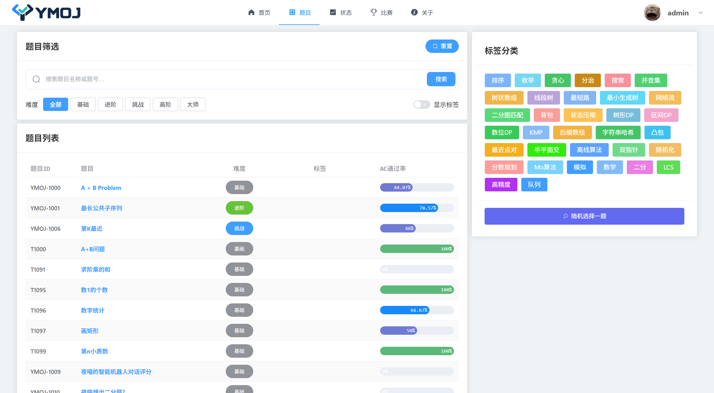](docs/assert/pc-problems.png) | [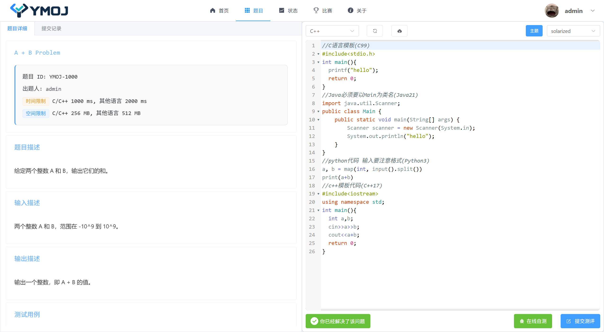](docs/assert/pc-problem-detail.png) |

| 提交状态 | 比赛列表 |
| --- | --- |
| [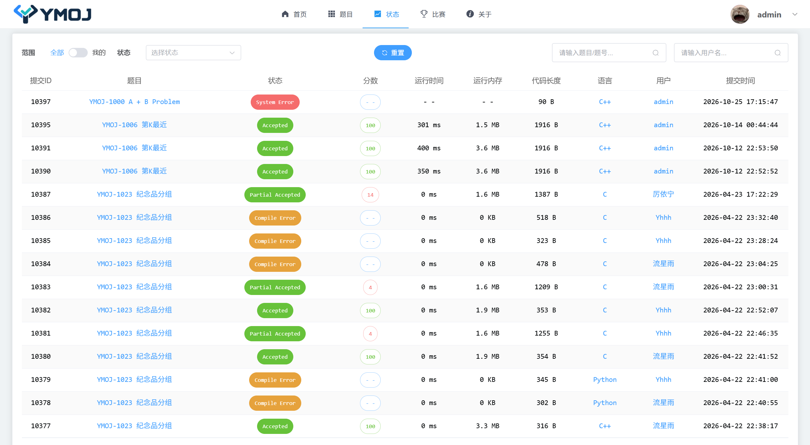](docs/assert/pc-status.png) | [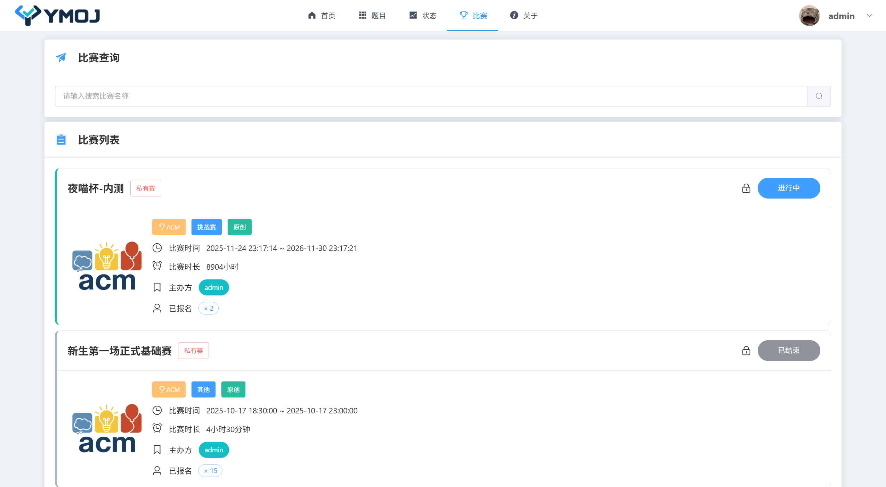](docs/assert/pc-contests.png) |

<details>
<summary>查看编译环境、语言示例与判题说明</summary>

[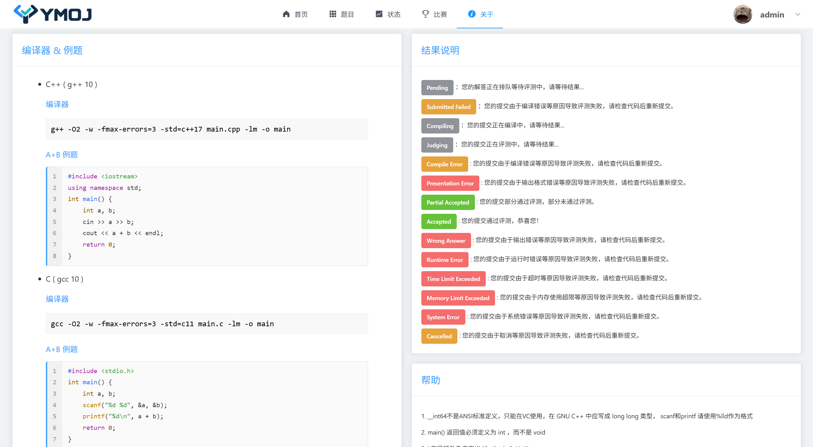](docs/assert/pc-about.png)

</details>

### 管理后台

从题库维护、比赛组织到网站配置，常用管理功能集中在同一套后台中。

| 题目与测试用例管理 | 比赛管理 |
| --- | --- |
| [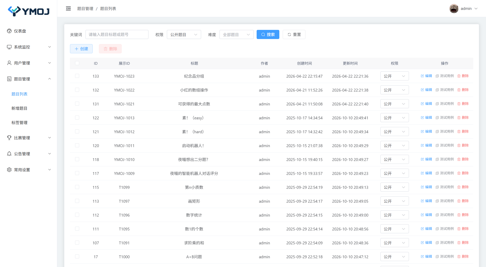](docs/assert/pc-admin-problems.png) | [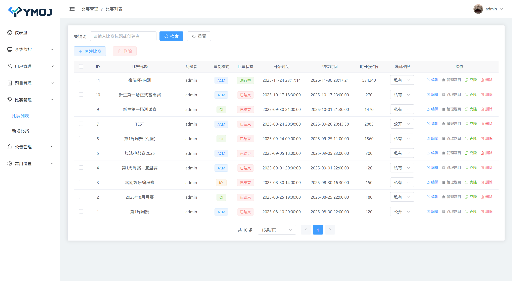](docs/assert/pc-admin-contests.png) |

| 公告管理 | 系统配置与轮播管理 |
| --- | --- |
| [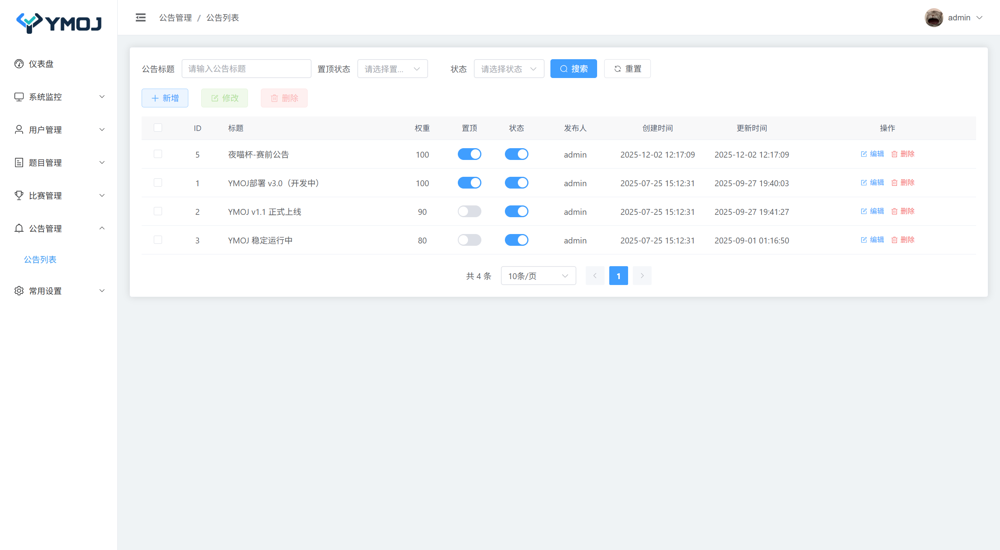](docs/assert/pc-admin-announcements.png) | [](docs/assert/pc-admin-settings.png) |

| 角色管理 | 菜单与权限管理 |
| --- | --- |
| [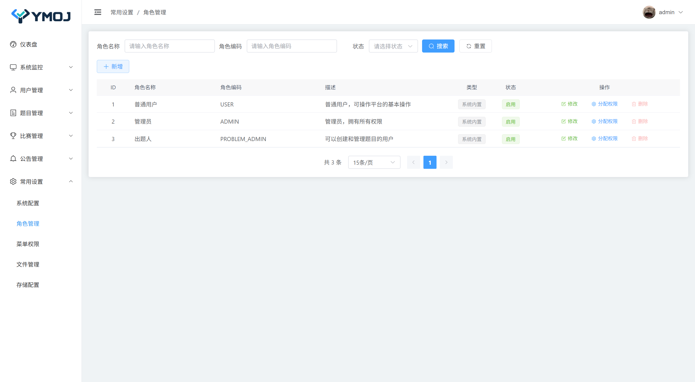](docs/assert/pc-admin-roles.png) | [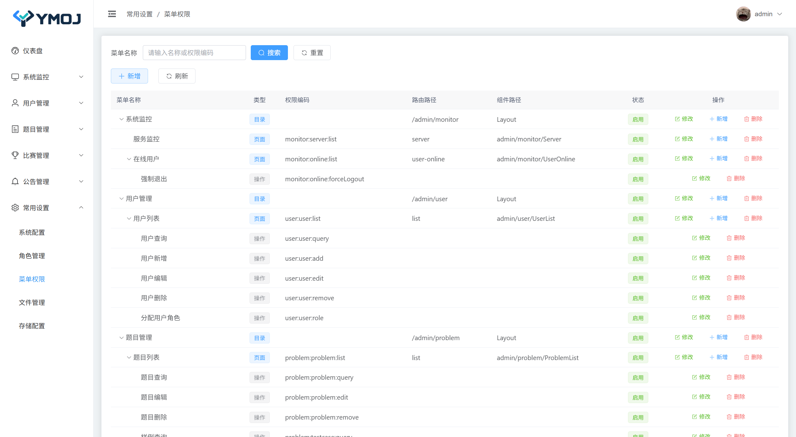](docs/assert/pc-admin-menus.png) |

### 手机端

首页与比赛列表适配窄屏，手机上也能查看公告和赛事信息。

<p align="center">
  <a href="docs/assert/mobile-home.png">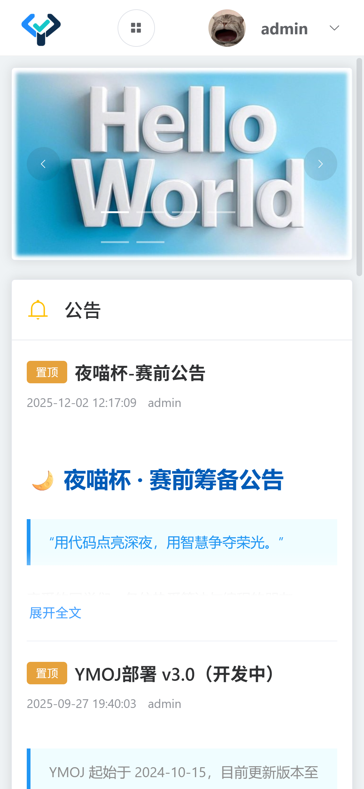</a>
  &nbsp;&nbsp;
  <a href="docs/assert/mobile-contests.png">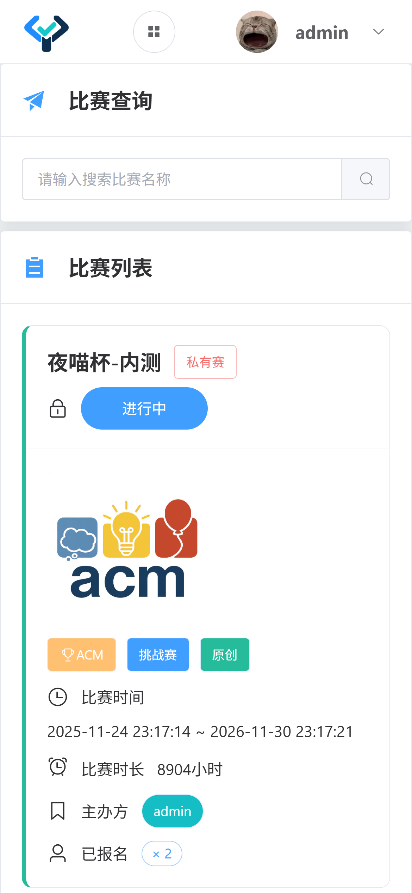</a>
</p>

## 技术架构

```text
                     Vue 3 + TypeScript
                       OJ 页面 / 管理后台
                               │
                               ▼
                       Spring Boot Web
                    业务接口 · 鉴权 · 任务持久化
                       │       │       │
                       ▼       ▼       ▼
                     MySQL   Redis  RabbitMQ
                                       │
                                       ▼
                                 Judge Worker
                              测试数据准备 · 结果汇总
                                       │
                                       ▼
                               go-judge 执行沙箱
                              C / C++ / Java / Python
```

| 层次 | 技术选型 |
| --- | --- |
| 前端 | Vue 3、TypeScript、Vite、Pinia、Vue Router |
| 界面与编辑 | Element Plus、XFlex、CodeMirror、md-editor-v3、ECharts |
| 后端 | Java 17、Spring Boot 3、Spring Security、MyBatis-Plus |
| 数据与消息 | MySQL、Redis、RabbitMQ |
| 评测 | 独立 Java Worker、go-judge、Linux 沙箱 |
| 部署 | Docker Compose、腾讯云 / Docker Hub 镜像 |

## 搭建你自己的 OJ

部署文件发布在 **[ymoj-deploy](https://gitee.com/yemiaoo/ymoj-deploy)**，包含 Compose 配置、`.env` 和数据库初始化文件。无需编译源码或安装 Java、Maven、Node。

1. 准备 Linux amd64 服务器，启用 cgroup v2，安装 Docker Engine 与 Docker Compose v2.20 及以上。
2. 下载部署仓库并进入目录，直接编辑已有的 `.env`。
3. 在该目录执行 `docker compose up -d`，等待服务启动后访问网站。

建议从 **2 核 CPU、4 GB 内存**起步，再按判题并发与题目资源需求扩容。

👉 **[查看完整部署步骤、服务端口与初始账号](deploy/README.md)**

## 参与开发

```text
ymcloud-common   通用工具、常量与异常
ymcloud-pojo     实体、DTO、VO 与判题消息契约
ymcloud-core     鉴权、数据访问、缓存、消息与文件存储
ymcloud-web      OJ 与后台业务接口
ymcloud-judge    独立判题 Worker
ymcloud-vue      OJ 前端与管理后台
sql             当前版本建表与必要初始化数据
deploy          镜像发布所用的源配置模板
```

后端采用 Maven 多模块组织，前端代码集中在 `ymcloud-vue`。完整网站部署见[部署指南](deploy/README.md)，独立沙箱运行见 [go-judge 部署文档](docker/go-judge/README.md)。

欢迎通过 [Issue](https://gitee.com/yemiaoo/ymcloud/issues) 反馈问题、提出建议，或通过 [Pull Request](https://gitee.com/yemiaoo/ymcloud/pulls) 参与改进。提交问题时请附上版本、复现步骤与脱敏日志。

## 开源许可

本项目采用 [MIT License](LICENSE)。感谢 [go-judge](https://github.com/criyle/go-judge) 及项目依赖的开源工具与社区。
